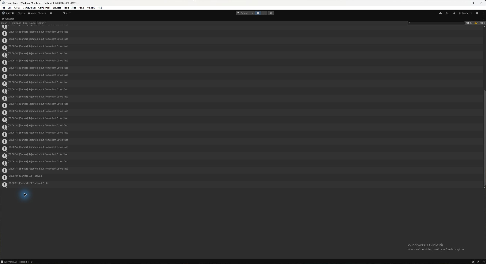

# Week 04 - Homework 2: The server decides

Unity 6000.3.2f1, FishNet official 4.7.3 tag, 30 ticks/second. Continue the Week03 Pong scene at `Pong/Assets/Scenes/Pong.unity`.

## Part A - Stop trusting the client

### Step 1 - Client Authoritative off

`Paddle.prefab` has `_clientAuthoritative: 0` and `_sendToOwner: 1`. The Ball prefab already has both settings. The server's position now goes to every client, including the paddle owner. The prefab setup helper also uses server authority so running it cannot restore client authority.

The temporary Step 1 state is preserved in commit `147f51c`: before the input RPC exists, client movement is overwritten by the server. This intermediate state was not separately play-tested.

### Step 2 - Input up, position down

`PaddleController.OnStartNetwork` subscribes to `TimeManager.OnTick`; `OnStopNetwork` unsubscribes. On each tick the owner reads W/S or arrows and sends -1, 0 or +1 through the ownership-required `ServerSetAxis` RPC. Zero is sent too, so releasing a key stops movement. The server stores the accepted axis and moves once per tick using `speed * TickDelta`, then calls `Court.ClampPaddle`. `Update` retains Space/serve and the deliberately insecure T experiment; it no longer performs normal movement.

Input travels client -> server; position travels server -> everyone. The owner waits for this round trip instead of predicting locally. RTT is a round-trip measurement, not an exact input-to-display measurement; tick scheduling and NetworkTransform interpolation also contribute.

Measured nonzero loopback RTT was **7-33 ms** for both players; zero entries occurred during initialization. These are local measurements, not a two-computer test.

### Step 3 - Check the input

The server rejects NaN, clamps the axis to [-1, 1], and refuses spectator input before changing movement state. FishNet's default `[ServerRpc]` ownership check also stops another client from writing this paddle's input.

**Answer:** when the server receives `axis = 50`, `axis = Mathf.Clamp(axis, -1f, 1f);` changes it to 1. This line runs **on the server** inside `ServerSetAxis`. The tick then uses the same normal speed of 8 units/second. Positive/negative infinity also become +1/-1 through this clamp; NaN must be rejected separately.

## Part B - The rate limit

### Step 4 - No second input inside 30 ms

`MinInputGap = 0.030` seconds. Each paddle has its own `_lastInputTime = -1`, `_serverAxis`, and `RejectedInputs`; no timestamp is static. Time comes from `TimeManager.TicksToTime(TimeManager.Tick)` on the server, not a client clock. The first well-formed player input is accepted. A later input less than 30 ms after the last accepted one increments the counter, logs `[Server] Rejected input from client {OwnerId}: too fast.`, and returns without changing the axis or the accepted timestamp.

The server HUD shows `Rejected inputs (paddle N): count`. Its callback is removed on server stop, and values reset on server start, avoiding stale panels after reconnects.

**Why 30 ms?** At 30 Hz, one tick lasts about 33.33 ms; 30 ms permits a normal input each tick while refusing multiple inputs processed during the same tick.

**What about 5 ms?** It still rejects a same-tick burst with this tick-based clock, but permits a higher input frequency if the server tick rate is raised. It is a weaker time threshold; at the current 30 Hz it does not create five-millisecond clock precision.

**What about 500 ms?** Only roughly two inputs per second are accepted. Movement direction and key release are delayed, making the paddle unresponsive and causing unwanted continued motion between accepted inputs.

This is an input acceptance limit, not a bandwidth limit: the packets still reach the server. It does not prove that every rejected packet is cheating. Normal packets can arrive in one tick and produce occasional rejections.

## Part C - Prove it

### Step 5 - The cheating client

Use a **separate server and two clients**, not a host sharing server state. Click the owning client game window before pressing a key.

| Key | Client action | Expected server behavior |
| --- | --- | --- |
| C | Send `ServerSetAxis(1f)` 20 times in one frame | One accepted input and 19 rejections when the previous accepted input was at least 30 ms ago; movement stays at normal speed. |
| X | Send `ServerSetAxis(50f)` once | Accepted value is clamped to 1; movement never becomes 50 times faster. |
| T | Copy the ball's position to the client's paddle transform, with no RPC | Server position and ball collision stay unchanged; subsequent authoritative position updates correct the client. |

The normal tick sender remains enabled during manual play. If it already sent an accepted input in the same server tick, C can add **20** rejections instead of 19; X can also be rate-limited. The isolated automated burst pauses only the test client's normal sender first, ensuring exactly 19. Network arrival, interpolation and whether the server transform changed affect visible T correction time; a literal one-tick visual guarantee must be checked separately.

T is disabled on a host because that process shares the actual server transform; this experiment must change only a separate client's copy. T also checks that a ball exists.

The server calls `NetworkTransform.ForceSend()` after moving/clamping each tick. This also resends idle positions, preventing T from persisting when the server paddle has stopped and change-only replication would otherwise send nothing. This trades additional idle transform traffic for prompt authoritative correction; interpolation and transport delay still apply.

**1. Why is C not 20 times faster?** The RPC stores an axis rather than moving anything, and the server moves once per tick at `speed * TickDelta`, irrespective of how many RPCs arrive.

**2. Why did the server ball not notice T?** T changes only the separate client's transform; server-authoritative NetworkTransform does not upload it, and ball collision uses the server's paddle position.

**3. Which cheats fail without the rate limit?** X still fails because the server clamps 50 to 1, T still fails because the client cannot change server position, and even C cannot multiply movement speed because receiving input does not execute a movement step; the rate limit additionally rejects/counts the spam.

### Vocabulary and the pointed-at line

- **Server authority:** the server decides the game state; clients request actions and display the server's result.
- **Rate limiting:** accepting requests only when the minimum allowed time since the last accepted request has elapsed.
- Pointed-at line: `axis = Mathf.Clamp(axis, -1f, 1f);` validates the magnitude on the server. `_serverAxis = axis;` stores intent; `transform.position += ... TickDelta` applies it once per server tick.

### Running the checks

Build a Windows development player using `PongReplicateSetup.BuildPlayer`, then run `python tests/run_hw2.py`. It launches the real transport with one server, two players and one spectator. `Homework2Probe` is opt-in with `-hw2-test`, injects a virtual keyboard for the normal input path, and invokes the real RPC wrapper for invalid-input experiments. It never directly calls generated server RPC logic. Without `-hw2-test`, the probe does not run. The old `-smoke` probe now sends virtual keyboard input rather than writing client positions.

Raw test evidence and a machine-readable summary are in `evidence/`. No human two-computer or Multiplayer Play Mode test is implied by automated loopback results. The lecture notes and exact vocabulary list were not supplied; the definitions above explain the two central terms in the assignment. The optional one-second serve limit/TOO FAST extension is not implemented.

### Verified results - 22 October 2026



This is the real Unity Editor server Console, with Collapse off. A separate development client ran the opt-in probe's one 20-RPC C-equivalent burst. The 19 consecutive entries at 01:06:14 show the burst rejections; entries at earlier times are ordinary input-arrival rejections. This capture is automated RPC evidence, not a claim of a physical C keypress. The same run also shows serve and scoring messages. The screenshot run is separate from the four-process JSON report below.

Unity Windows development build succeeded. **12/12 real-transport checks passed** (`evidence/test-summary.json`): server/two-player/spectator roles, exactly 19 consecutive C rejections, finite/clamped positions, unchanged server paddle X positions, maximum movement speed, normal owner input, spectator restrictions, the other player's movement during spam, T correction, X/NaN/infinity attempts, serve/goal, and no runtime exceptions.

The T action logged the client's immediate X as 0; the first subsequent 100 ms sample already showed authoritative X=-7, before the next scripted movement. This confirms correction at the sampling resolution, not its exact sub-frame latency.

The final server counters were 27 (left), 79 (right), and 0 (spectator). The C burst itself accounts for exactly 19 consecutive left rejections; other counts include normally generated inputs arriving together. This multi-process test produced more normal-input rejections than the assignment's illustrative one-or-two-per-minute expectation. The server still moved each paddle at most once per tick, and the independent movement checks passed. Do not present the total counter as a count of proven cheats.

Build and test commands on Windows:

```powershell
unity run ./Pong --editor-version 6000.3.2f1 -- -nographics -executeMethod PongReplicateSetup.BuildPlayer
python tests/run_hw2.py
python tests/run_hw2.py --check-only # evaluate the existing saved run
```

The starting Week03 implementation was reviewed and its previously recorded checks retained. The Homework2 tests reverified one active ball's serve and scoring path; the transient Step 1 and Step 2 states were saved in separate commits, without claiming separate runtime measurements of each transient state.
