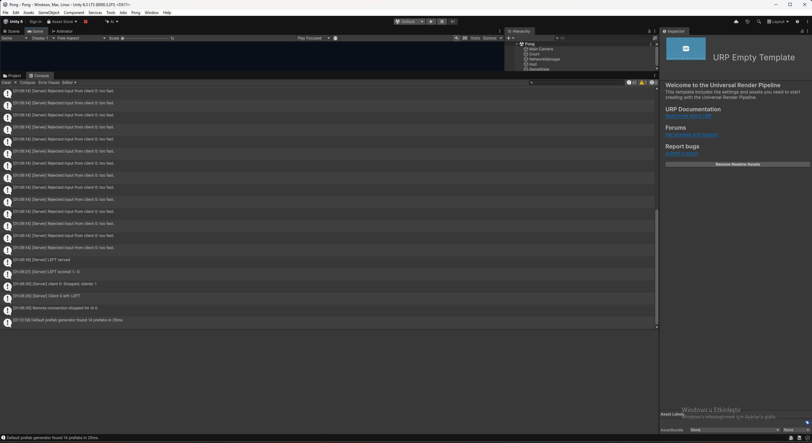

# Week 04 - Homework 2: The server decides

For this homework, I continued my Week03 Pong project and changed the paddles to server authority. I used Unity **6000.3.2f1**, FishNet's official **4.7.3** tag, and **30 ticks per second**. My networked scene is `Pong/Assets/Scenes/Pong.unity`.

## Part A - Stop trusting the client

### Step 1 - Client Authoritative off

I turned off Client Authoritative on the Paddle prefab and enabled Send To Owner. I also checked the Ball prefab, which already had these settings. The server now sends the paddle position to every client, including its owner. I updated the prefab setup helper too, so running it does not turn client authority back on.

I saved this step in commit `147f51c`. At this stage, before adding the input RPC, a client's local movement would be overwritten by the server. I did not run a separate play test of this intermediate commit.

### Step 2 - Input up, position down

I removed normal paddle movement from `Update`. I kept the owner check and Space/serve code, then subscribed to `TimeManager.OnTick` in `OnStartNetwork` and unsubscribed in `OnStopNetwork`.

On each tick, the owner reads W/S or the arrow keys and sends -1, 0 or +1 through `ServerSetAxis`. I send 0 when no key is held, so the server knows when to stop the paddle. The server stores the accepted value in `_serverAxis`, moves the paddle once per tick using `speed * TickDelta`, and calls `Court.ClampPaddle`.

The input goes from client to server, and the resulting position goes from server to everyone. My owner client therefore waits for the server's update. In the automated loopback test, the nonzero RTT readings were **7-33 ms** for both players. RTT measures the round trip; tick timing and interpolation also affect the visible delay.

### Step 3 - Check the input

I added three checks on the server: reject NaN, clamp the axis to [-1, 1], and reject spectator input. I kept the RPC's default ownership requirement so a client cannot send input for another player's paddle.

**If the server receives `axis = 50`, which line keeps the speed normal, and where does it run?**

`axis = Mathf.Clamp(axis, -1f, 1f);` changes 50 to 1. It runs **on the server**, inside `ServerSetAxis`. The server then uses the normal speed of 8 units per second. The same clamp handles positive and negative infinity, while NaN is rejected before it reaches the movement state.

## Part B - The rate limit

### Step 4 - No second input inside 30 ms

I set `MinInputGap` to `0.030` seconds. Each paddle has its own `_lastInputTime`, initialized to -1, and its own `RejectedInputs` counter. I did not use a static timestamp, because one player's requests should not block another player.

I get the server time with `TimeManager.TicksToTime(TimeManager.Tick)`. After checking the input, I compare this time with the last accepted request. If the gap is less than 30 ms, I increment the counter, log `[Server] Rejected input from client {OwnerId}: too fast.`, and return. Otherwise, I save the timestamp and axis.

I added the rejection count to the server HUD. I remove the panel callback when the server stops and reset the values when it starts again.

**Why 30 ms?** At 30 ticks per second, a tick lasts about 33.33 ms. A 30 ms limit allows normal input each tick but rejects extra requests processed in the same tick.

**What happens with 5 ms?** With the current tick-based clock, a same-tick burst is still rejected. However, 5 ms would allow more frequent inputs at a higher server tick rate. It does not give this 30 Hz clock five-millisecond precision.

**What happens with 500 ms?** The server accepts only about two inputs per second. Direction changes and key releases become delayed, so the paddle feels unresponsive and can keep moving after a key is released.

The limit controls accepted requests. Packets still reach the server, and ordinary packets can also be rejected when they arrive together, so I do not treat every rejection as proof of cheating.

## Part C - Prove it

### Step 5 - The cheating client

I added the three debug keys to the owning client's `Update`:

| Key | What I added | What the server does |
| --- | --- | --- |
| C | Call `ServerSetAxis(1f)` 20 times in one frame. | In an isolated burst, accept one input and reject the other 19. Movement stays at normal speed. |
| X | Call `ServerSetAxis(50f)` once. | Clamp the accepted axis to 1, so the paddle cannot move 50 times faster. |
| T | Set the client's paddle position to the ball's position without an RPC. | Keep the server position unchanged and correct the client's position through authoritative updates. |

I kept normal tick input enabled during gameplay. If an input has already been accepted in the same server tick, C can produce 20 rejections rather than 19, and X can also be rate-limited. For the isolated automated C test, the probe temporarily pauses its normal input sender before sending the 20 requests.

I restricted T to a separate client and checked that a ball exists. A host shares the server transform, so it would not be a valid client-only teleport test. I also call `NetworkTransform.ForceSend()` on the server each tick so an idle paddle still receives corrections. This increases idle transform traffic, and the visible correction still depends on network delay and interpolation.

**1. Why does C not make the paddle 20 times faster?** My RPC stores an axis; it does not move the paddle. The server moves once per tick using `speed * TickDelta`, regardless of the number of requests.

**2. Why does the server ball not notice T?** T changes only the separate client's copy of the paddle. The server does not accept that position, and ball collision uses the paddle position on the server.

**3. Which cheats would fail without the rate limit?** X would still fail because of the clamp, and T would still fail because the server controls position. C would not multiply movement speed either, because receiving an input does not execute a movement step. The rate limit additionally rejects and counts the spam.

### My server Console screenshot



This screenshot shows the server's rejection messages at 01:06:14, followed by serve, score and disconnect messages. The messages came from a separate test client's automated 20-request C-equivalent burst. I have included the screenshot here alongside the saved test evidence; it does not represent a separate physical-keyboard test.

### My test results

The Windows development build succeeded, and **12/12 automated real-transport checks passed**. The results are in [`evidence/test-summary.json`](evidence/test-summary.json), with the recorded samples in the other evidence files.

The test used one server, two players and one spectator on the same computer. It checked the C burst's 19 consecutive rejections, normal movement, speed and court limits, spectator restrictions, the other player's movement during spam, T correction, X/NaN/infinity input, serving, scoring and runtime errors.

For T, the client's immediate X position was logged as 0. In the first subsequent 100 ms sample, it was back at the authoritative X=-7, before the next scripted movement. This confirms correction at that sampling resolution; I have not measured an exact one-tick visual correction time.

The final server counters in this four-process test were 27 for the left player, 79 for the right player and 0 for the spectator. Exactly 19 consecutive left-player rejections came from C. The remaining rejections included normal inputs arriving together. This was more frequent than the assignment's example of one or two normal rejections per minute, but both paddles still passed the independent movement and speed checks. The Console screenshot was captured in a separate run from this four-process report.

I have not run a new two-computer or Multiplayer Play Mode test for Homework 2. I saved Steps 1 and 2 as separate commits, but tested the completed implementation rather than measuring each intermediate version separately. I left out the optional one-second serve cooldown and TOO FAST message.

### Two vocabulary words and the pointed-at line

- **Server authority:** the server decides the game state. In my game, clients send input and display the positions decided by the server.
- **Rate limiting:** accepting requests only after a minimum time gap. In my implementation, each paddle waits at least 30 ms between accepted inputs.
- The line I would point to for the speed-hack check is `axis = Mathf.Clamp(axis, -1f, 1f);`. `_serverAxis = axis;` stores the accepted input, and the movement line using `TickDelta` applies it once per server tick.

### Running my checks

I used `PongReplicateSetup.BuildPlayer` to build the Windows development player and `tests/run_hw2.py` for the automated network checks:

```powershell
unity run ./Pong --editor-version 6000.3.2f1 -- -nographics -executeMethod PongReplicateSetup.BuildPlayer
python tests/run_hw2.py
python tests/run_hw2.py --check-only
```

`Homework2Probe` runs only with `-hw2-test`. It uses a virtual keyboard for normal movement and invokes the real RPC wrapper for the invalid-input tests. It does not call the generated server RPC logic directly. I also updated the older `-smoke` probe to send keyboard input instead of writing the client's paddle position.
