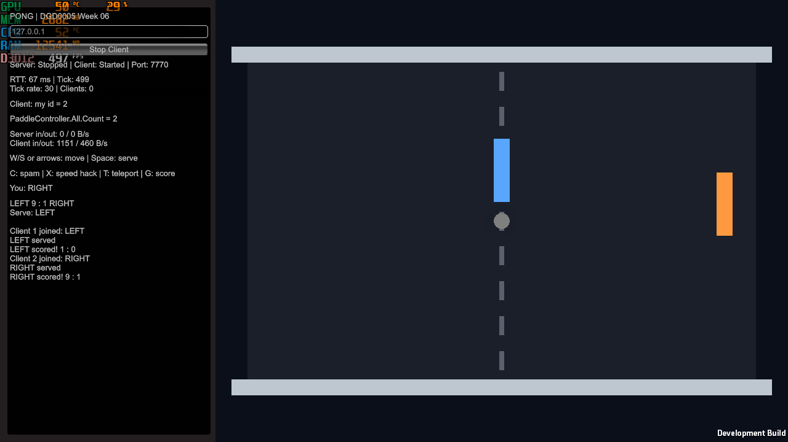

# Homework 3 — The Host Cheats, and the Join Code

I continued my Homework 2 Pong project in Unity 6000.3.2f1 with FishNet 4.7.3.
I also included my previous Week05 assignment from `hw3.zip`: its report, host diagnostics, and player-departure ball reset and serve transfer. I merged these files with the new Week06 changes instead of replacing the current project.
This report separates the implemented behavior from tests I have actually recorded.

## Before starting

- Server-authoritative paddle NetworkTransform; 30 ms input limit; C, X and T retained.
- Start Host starts the server and its local client. Stop Host stops both.
- For Multiplayer Play Mode, use one guest instance without the `Server` tag.
- Week 6 lecture notes were not supplied, so the Relay implementation follows the package API and the homework requirements.

## Step 1 — Guest cheats

I added G as a direct `LeftScore.Value = 9` write, without an RPC.
A guest cannot publish a SyncVar write to the server: the server owns the shared score and sends updates to clients.
A local write cannot become an authoritative score change.

| Key on guest | Expected host result | Expected visible result |
| --- | --- | --- |
| C | Burst input rejected by the 30 ms limit | Normal paddle speed |
| X | Axis clamped to [-1, 1] | Normal paddle speed |
| T | No server position change | Guest-only jump, then server correction |
| G | No server score change | Host score unchanged |

Exactly 19 C rejections assumes no normal tick input was accepted in the same tick; otherwise all 20 burst requests can be refused.

## Step 2 — Serve rate limit

I keep a separate timestamp on each paddle. After validating the state, ball and side, I check one second before checking the serving rule.
I update the timestamp for every well-formed attempt, including a wrong-turn request. A refused burst sends `TOO FAST` only to `Owner` through a TargetRpc.
After one second the next request reaches the serving-rule check again; it can serve only on that player's turn with an idle ball.

## Step 3 — Host cheats

1. C and X pass through checked requests; T and G directly edit the authoritative objects when run on the host.
2. The guest can see the host's T teleport, G score edit and Inspector speed change after replication.
3. For ranked games with strangers I would choose a dedicated server, because a player-host controls the authoritative process and its rules.

| Host action | Expected result |
| --- | --- |
| C | Input rate limit still applies |
| X | Axis clamp still applies |
| T | Teleport reaches both windows |
| G | LEFT becomes 9 in both windows |
| Speed 8 → 40 | Host paddle moves five times faster, replicated to guest |

I captured the guest after the host pressed G in the automated two-process test. LEFT is 9 and the host's teleported paddle is visible near the centre.

## Step 4 — Packages and transport

UnityTransport is the active transport on the NetworkManager, with direct connections on port 7770. Tugboat stays on the object unused.
The manifest installs Multiplayer Services and the homework's FishyUnityTransport Git package.
I linked the existing `Pong` cloud project in the `Shenelise` organization through Unity's Services settings. The public project ID is `5cd07c88-6c56-485a-b733-2cf050b5f6b7` and is saved in ProjectSettings so clones use the same project. Relay is operational: the live allocation and join test below succeeded.

## Step 5 — RelayLink

- `CreateAllocationAsync(1)` returns an allocation containing Relay endpoint and connection data for one guest plus the host.
- `GetJoinCodeAsync(allocation.AllocationId)` returns the shareable join-code string for that allocation.
- I set Relay server data before `StartConnection` so the transport starts with the allocated endpoint, credentials and Relay protocol.

## Step 6 — Two buttons and a code

I added Host via Relay, a join-code field and Join via Relay. While a request is busy, connection buttons are disabled.
The host displays JOIN CODE while its server is running. Stop Host clears the code.
Initialization uses a distinct anonymous authentication profile per process so host and guest on one PC do not reuse the same player.
Relay errors appear in the Console and on the initiating HUD; failures release the busy flag.

I ran a live Relay test using the actual HUD host/join methods in two separate Windows player processes. The host received a six-character join code, the guest joined with that code, both players saw the ball in play, and the host's score edit reached the guest. **7/7 Relay checks passed**. Guest RTT readings after initialization were **67, 73, 75, 78, 83 and 100 ms**; the captured frame shows **67 ms**. Initial 0 ms samples precede the first ping result.

These two processes used the same physical computer and internet connection. They contacted the real Unity Relay service; this is not the required two-network partner test. The score of 9 in the screenshot is the deliberate G experiment, not a claim of a match played to 3.

Results: [Relay checks](evidence/relay/test-summary.json), [host log evidence](evidence/relay/host.txt), [guest log evidence](evidence/relay/client.txt). Reproduce after building with `python tests/run_hw3.py --relay --screenshots`.

## Step 7 — Partner on another network

1. Host and guest each connect to a public Relay endpoint, which forwards the game packets between them; authority remains on the host.
2. Both devices make outgoing connections, so neither player needs to configure router port forwarding.
3. The extra delay comes from the longer network route through Relay and its forwarding, compared with loopback on one computer.

| Connection card | Recorded value |
| --- | --- |
| Partner's name | My sibling; name not supplied |
| Host / guest | Verified: local host LEFT and separate guest RIGHT. Planned physical run: me hosting, my sibling joining; then swap. |
| Two networks | Current test: one computer / one connection. Planned physical run: home internet and phone hotspot; not performed yet. |
| Guest Relay RTT | Verified same-computer Relay: 67–100 ms after initialization; 67 ms in the screenshot. Different-network RTT remains unmeasured. |
| Guest loopback RTT | 0 ms in the captured graphical test; this is loopback, not a Relay measurement |
| First try / fix line | Live Relay smoke test passed on its first run after linking the cloud project. Different-network attempt not performed. |
| Play to 3 and swap hosts | Pending real partner test |
| Guest screenshot with RTT and score | Captured for the live same-computer Relay test above. A different-network screenshot remains pending. |

I must use the same cloud project for each host's code: my partner runs my project when I host, and I run theirs when they host.
A join code expires when its host stops.

### My two-computer test procedure

1. On both computers, clone this repository and open `Pong` with Unity 6000.3.2f1. Wait for package installation to finish.
2. Keep the included Pong Unity Cloud project settings unchanged so both copies use the same project. This project has already passed a real Relay allocation and join test. Never commit passwords or access tokens.
3. Use home internet on one computer and a phone hotspot on the other. Two computers on the same home Wi-Fi do not meet the different-network requirement.
4. First measure a direct loopback guest on the host computer using Start Host and Start Client at 127.0.0.1. Record its HUD RTT, then stop both.
5. Select Host via Relay, send the displayed code to my sibling, and select Join via Relay on the other computer. Do not enter an IP address.
6. Play to 3, record the guest RTT and take a guest screenshot showing RTT and score. Fill the card with actual network names and results.
7. Swap hosting roles and repeat. The original partner-repository requirement needs a separate partner project; swapping two copies of my repo tests both host directions but does not prove that separate-repository requirement.

If hosting fails immediately, check project linking, Relay enablement and internet access. If joining fails, check the code, whether the host is still running and that both copies use the same cloud project.

## Vocabulary and pointed-at line

- **Listen server:** a player process running both the authoritative server and a local client.
- **Relay allocation:** reserved forwarding capacity and connection data for a host and its guests.
- Line I can explain: `TargetRefused(Owner, "TOO FAST");` targets only the requesting paddle's owning connection, leaving the other player's HUD unchanged.

## Verification

I built a Windows development player successfully in Unity 6000.3.2f1 with the installed Relay packages. The C# compiler reported no errors. The asset checker reported zero errors and three warnings in unchanged FishNet source files. I removed four stale missing-component references from the template's default volume profile.

I ran `python tests/run_hw3.py --screenshots` with a real UnityTransport listen host and a separate guest process on the same computer. **15/15 automated checks passed**; [the machine-readable results](evidence/test-summary.json), [host evidence](evidence/host.txt) and [guest evidence](evidence/client.txt) are included.

The checks cover host LEFT/guest RIGHT, guest G isolation, targeted serve refusal, the other player's serve, guest T correction, C rejection on both players, host T/G replication, exercising all four cheat keys, applying host speed 40, expiry of the one-second serve cooldown, movement exceeding speed 8 after the host's speed edit, absence of detected runtime errors, and guest screenshot capture. The exact five-times movement ratio and the X clamp were not separately numerically asserted.

I separately ran the live Unity Relay test described in Step 6: **7/7 checks passed**, including a real allocation, code-based guest join, RTT, ball and score replication. These observations supplement the **15/15 direct loopback checks**; they do not establish manual keyboard-focus behavior or a two-network partner match.

I have not yet tested with my sibling across two networks, played that partner match to 3, or completed the separate-partner-repository swap. The connection card distinguishes measured results from the planned physical test. The supplied Week06 homework PDF is the requirement source; Week06 lecture notes were not supplied or present in the repository.

## Sources

- [FishyUnityTransport API and Relay setup](https://github.com/ooonush/FishyUnityTransport)
- [Unity Relay setup](https://docs.unity.com/ugs/en-us/manual/relay/manual/get-started)
